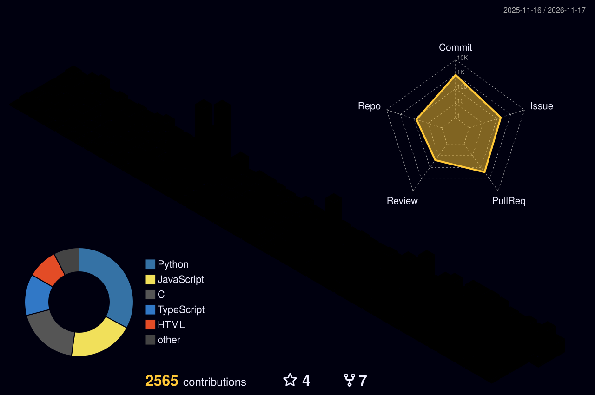

I'm a final-year CS student at REVA University (Bengaluru) and an SDE intern on the manufacturing-systems team at Cepheid (Danaher). Most of my spare time goes into open source, mainly PostgreSQL backup and recovery: reading unfamiliar codebases, finding correctness bugs, and getting the fixes merged with a reproduction and a test attached.

---

## Open source

Correctness fixes, each with a reproduction and a regression test where the project supports one.

**Highlights**

- **PostgreSQL core:** author of [*Reject incremental backups based on a backup from a divergent history*](https://git.postgresql.org/gitweb/?p=postgresql.git;a=commit;h=316861101e8) (master, back-patched to 17 and 18). After a failover, an incremental backup could be combined with pages from the abandoned timeline.
- **pgmoneta:** 120+ commits, and the deep `verify` for incremental backup chains: it reconstructs the chain and checks page checksums, the visibility map and every backup it depends on, without a full restore. Triage role on the pg-family repositories.
- **Also contributing to:** [Bitcoin Core](https://github.com/bitcoin/bitcoin/pulls?q=author%3APranav-error) (RPC tests), [GStreamer](https://gitlab.freedesktop.org/gstreamer/gstreamer/-/merge_requests?author_username=rajasaipranav0) (tag demuxing fix and tests), [Vitess](https://github.com/vitessio/vitess/pulls?q=author%3APranav-error) and [etcd](https://github.com/etcd-io/etcd/pulls?q=author%3APranav-error).

&nbsp;

&nbsp;

<!-- OSS:START -->

| Project | Contribution | Status |
|:--|:--|:--|
| **[pgmoneta](https://github.com/pgmoneta/pgmoneta)** | Deep `verify` for incremental backup chains (reconstruct, page checksums, visibility map, every backup in the chain), PostgreSQL 14-16 incremental fixes, and memory-safety fixes across the codebase | **135 merged** · 2 open |
| **[pgagroal](https://github.com/pgagroal/pgagroal)** | An unbounded `strcat` stack overflow in the CLI, unchecked reallocs, and silent truncation in the numeric append helpers — found by writing the corner-case tests | **20 merged** · 7 open |
| **[pgvictoria](https://github.com/pgvictoria/pgvictoria)** | Cross-ported allocation checks and string-helper fixes, with corner-case tests for the append family | **20 merged** · 2 open |
| **[pgexporter](https://github.com/pgexporter/pgexporter)** | Unchecked allocations in the YAML and network paths, plus a kqueue accept-drain fix ported from pgagroal | **20 merged** · 1 open |
| **[grass](https://github.com/OSGeo/grass)** | Null pointer dereference in the vector library, a null *function pointer* crash in `v.to.rast`, 64-bit cell counters, and unbounded environment growth in the runtime setup | **5 merged** · 5 open |
| **[vitess](https://github.com/vitessio/vitess)** | Integer `DIV` and `*` overflow bugs in the evaluation engine, checked against MySQL 8.4 | 8 open |
| **[cisys](https://github.com/mnemosyne-systems/cisys)** | Modern Continuous Integration System | **7 merged** |
| **[etcd](https://github.com/etcd-io/etcd)** | `etcdutl snapshot restore` left a half-written data dir behind on failure; plus tighter error assertions in lease tests | 6 open |
| **[hiring-agent](https://github.com/interviewstreet/hiring-agent)** | AI agent to evaluate and score resumes. | 5 open |
| **[sktime](https://github.com/sktime/sktime)** | A unified framework for machine learning with time series | 5 open |
| **[gnuradio](https://github.com/gnuradio/gnuradio)** | QA test for the real-time scheduling bindings, and float-tolerance fixes for two numeric tests that compared approximations for bit equality | **4 merged** |
| **[jabref](https://github.com/JabRef/jabref)** | Repaired fetcher tests that broke when upstream metadata services changed their responses | **3 merged** |
| **[pgmoneta_ext](https://github.com/pgmoneta/pgmoneta_ext)** | PostgreSQL extension for pgmoneta | **3 merged** |
| **[IvorySQL](https://github.com/IvorySQL/IvorySQL)** | Found that a default `pg_upgrade` fails on Oracle-mode clusters with object types; reviews of Oracle-compatibility fixes | 3 open |

<!-- OSS:END -->

---

## Writing

- **[Two stack overflows hiding in plain sight](https://dev.to/pranav-error/two-stack-overflows-hiding-in-plain-sight-1on2)** — a `strcat` into 512 bytes in pgagroal and a `"%.8f"` into 30 bytes in GRASS GIS: how I found them, proved them, and picked the fix each project would accept.

---

## Featured projects

<table>
  <tr>
    <td width="50%" valign="top">
      <h3><a href="https://github.com/Pranav-error/claude-orchestrator">claude-orc</a></h3>
      
A control plane for Claude Code across multiple accounts and machines: git-backed memory sync, a skill registry, and token-usage reports parsed from local transcripts. Stdlib-only Python, 160+ tests in CI on 3.10–3.13, released to PyPI by CI.

      <code>pip install claude-orc</code>
    </td>
    <td width="50%" valign="top">
      <h3><a href="https://github.com/Pranav-error/evidence-verifier">Evidence Verifier</a></h3>
      
Is this invoice real? Checks whether a document's independent encodings agree — signed QR, text layer, line-item arithmetic, amount in words, PDF structure — instead of pixel forensics. Zero false positives across 9 independent corpora. Razorpay AI Buildathon.

    </td>
  </tr>
  <tr>
    <td width="50%" valign="top">
      <h3><a href="https://github.com/Pranav-error/infrx-mortgage-pipeline">Mortgage document pipeline</a></h3>
      
Splits 100–2,000-page mortgage packages into 27 document types at 91% accuracy. A cost-aware cascade keeps most pages away from the LLM; Naive Bayes stitches tables split across pages. 2nd place, InfrX 2026.

    </td>
    <td width="50%" valign="top">
      <h3><a href="https://github.com/Pranav-error/OrbitClean-2.0">OrbitClean 2.0</a></h3>
      
Waste intelligence for Bengaluru: Sentinel-2 dump detection, XGBoost risk prediction over a 552-cell grid, and route optimisation, behind a FastAPI + Next.js dashboard. Top 5, AWI SpaceTech Hackathon.

    </td>
  </tr>
</table>

All 40+ projects, grouped by area: **[saipranav.me](https://saipranav.me)** — or open the terminal there and type `ls projects`.

---

## Experience

- **SDE Intern, MES** — Cepheid India (Danaher) · Sep 2026 – present
- **Backend Developer (freelance)** — Contralyne, AI contract review · May – Sep 2026
- **Software Engineering Intern** — MyStartupWave · Dec 2025 – Aug 2026
- **Project Intern, Cybersecurity** — iSPIRT Foundation · Nov 2025 – Aug 2026
- **Research Intern, Explainable AI** — CSIR-4PI · Jul 2025 – Jan 2026

---

## Tools I use

---

## Contributions

&nbsp;&nbsp;

<picture>
  <source media="(prefers-color-scheme: dark)" srcset="https://raw.githubusercontent.com/Pranav-error/Pranav-error/output/github-snake-dark.svg"/>
  <source media="(prefers-color-scheme: light)" srcset="https://raw.githubusercontent.com/Pranav-error/Pranav-error/output/github-snake.svg"/>
  
</picture>

---

## 🏆 GitHub Trophies

---

## 😂 Random Dev Joke

---

## 💡 Dev Quote of the Day

